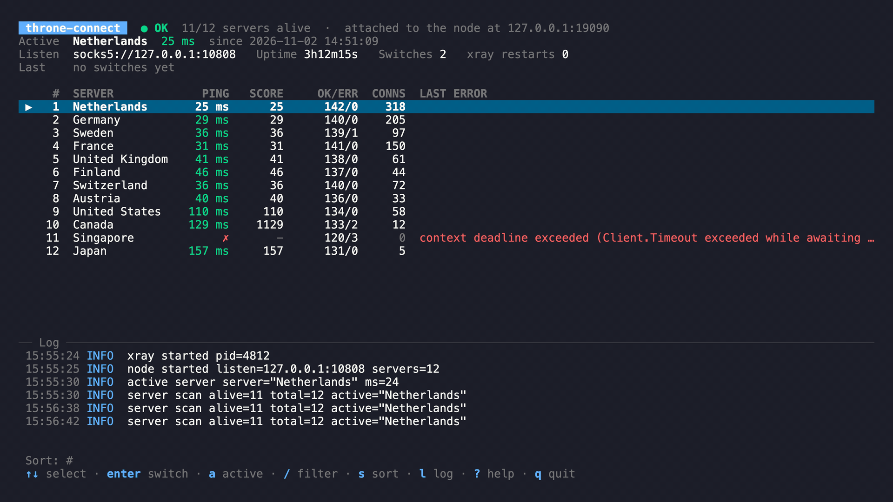

# throne-connect

[](https://github.com/hteppl/throne-connect/actions/workflows/ci.yml)
[](https://github.com/hteppl/throne-connect/releases/latest)
[](go.mod)
[](LICENSE)
[](https://github.com/hteppl/throne-connect/releases/latest)

A failover VPN node for [Throne](https://github.com/throneproj/Throne) (Windows and Linux).



throne-connect takes every xray profile (VLESS/VMess/Trojan/…) from Throne's database and keeps
them all up in a single xray-core process. It health-checks the servers continuously and exposes
one local SOCKS5 port that always leads to a working server. Throne connects to that port as an
ordinary proxy and keeps handling TUN, routing and DNS.

```
apps → Throne (TUN) → socks5://127.0.0.1:10808 → throne-connect
                                                   │  picks a healthy server
                              xray: 127.0.0.1:21000 … 21000+N
                                                   │
                                         NL  DE  FI  US …
```

On Linux it can also bring up the TUN itself instead of Throne, so only xray profiles still come
from Throne — see [Built-in VPN (TUN)](#built-in-vpn-tun).

## How failover works

- The active server is checked every `check_interval` (10s) by fetching `test_url` through it.
- After `fail_threshold` (2) consecutive failed checks the node switches to the best healthy
  server. The candidate is re-checked right before the switch.
- All other servers are checked every `scan_interval` (60s). A server's score is its median
  latency plus a 1000 ms penalty per failure among the last 10 checks, so a stable server
  beats a fast but flaky one.
- Switching is instant and does not touch Throne: new connections go to the new server right
  away. Connections stuck on the dead server are closed (`drop_on_failover`), so apps reconnect
  on their own.
- A working server is kept even when a faster one shows up. To move to faster servers, set
  `switch_better_ms` (e.g. 150): the node switches only if the gain exceeds that value and it
  has spent at least `min_dwell` (5m) on the current server.
- If no server responds (usually meaning the internet is down), the node does not flap: it stays
  on the current server and switches as soon as something comes back.
- xray is restarted automatically if it crashes (1s–30s backoff). On Linux xray dies together
  with the node.
- `throne.db` is re-read every `reload_interval`. If Throne refreshed the subscription, xray is
  restarted with the new list. If the new config fails `xray -test`, the node stays on the old
  one; individual broken servers are simply skipped.
- A server can be disabled from the TUI (`d`), the CLI or the API. A disabled server is not
  checked, is never switched to and gets no traffic. Disabling the active server first moves to
  the best working one (its connections are closed as on a failover); if no other server
  responds, it stays enabled. The choice is kept by server key in `state.json`, so it survives
  restarts and subscription refreshes. To drop servers permanently, use `exclude` in the config.
- The last active server and the server list are saved to `state.json`. After a restart the node
  resumes on the same server and keeps working even if `throne.db` is unavailable.

## Installation

Prebuilt archives are on the [Releases](https://github.com/hteppl/throne-connect/releases) page
for Linux (amd64, arm64, 386, armv6, armv7, riscv64), macOS (Intel, Apple Silicon), Windows
(amd64, arm64, 386) and FreeBSD (amd64, arm64), with `checksums.txt`. Each archive holds the
binary and the script that downloads xray-core for that platform (`get-xray.sh` or
`get-xray.ps1`). To build them yourself: `make dist VERSION=v1.2.3`.

Releases are published by pushing a tag: `git tag v1.2.3 && git push origin v1.2.3`
(a tag with a suffix such as `v1.2.3-rc.1` becomes a pre-release).

### Linux / macOS / FreeBSD

```sh
make build                 # or unpack a release archive into ./bin
./scripts/get-xray.sh bin  # download xray-core into ./bin
./bin/throne-connect list  # check that servers from Throne are visible
./bin/throne-connect       # run the node with the TUI (see below)
```

Autostart (systemd user unit):

```sh
mkdir -p ~/.local/bin ~/.config/systemd/user
cp bin/throne-connect bin/xray ~/.local/bin/
cp deploy/throne-connect.service ~/.config/systemd/user/
systemctl --user daemon-reload
systemctl --user enable --now throne-connect
journalctl --user -u throne-connect -f
```

### Windows

1. Put `throne-connect.exe` into its own folder and run
   `powershell -ExecutionPolicy Bypass -File get-xray.ps1` there to get `xray.exe` next to it.
2. Portable Throne keeps its database next to itself, so create a config with
   `throne-connect.exe init` and set the path in it, e.g.
   `"throne_db": "C:\\Throne\\config\\throne.db"`.
3. Check `throne-connect.exe list`, then double-click `throne-connect.exe`: it opens the TUI
   with the node running inside it.
4. Autostart at logon: `powershell -ExecutionPolicy Bypass -File install-windows.ps1`. The node
   then runs hidden in the background; open a terminal and run `throne-connect.exe` to see it.

### Docker (optional, Linux)

Native install is recommended: it is a single binary plus xray, with nothing else to manage.
The container is there for servers and for setups where you prefer Docker.

```sh
docker compose up -d --build
docker compose logs -f
docker compose exec throne-connect throne-connect status -c /etc/throne-connect/config.json
```

- The image builds throne-connect and downloads xray-core (`--build-arg XRAY_VERSION=v25.x.y`
  pins a release; the default is the latest).
- `network_mode: host` is required when Throne runs on the same machine. Throne's
  `process_name xray → direct` rule only sees xray as a local process; with a bridge network its
  traffic arrives NATed, the rule does not match, and connections loop back into the VPN.
- Throne's whole config dir is mounted (`throne.db` plus its `-wal`/`-shm` files) and the node
  opens the database read-only. Set `THRONE_CONFIG_DIR` if it is not in `~/.config/Throne/config`.
- The container runs as UID/GID 1000 by default. If your user differs, start it with
  `UID=$(id -u) GID=$(id -g) docker compose up -d`.
- To change settings, mount your own `throne-connect.json` over
  `/etc/throne-connect/config.json` by adding a volume
  (`- ./throne-connect.json:/etc/throne-connect/config.json:ro`). Keep
  `throne_db`, `xray_path` and `data_dir` as in `docker/config.json`.
- To serve other devices on the LAN (Throne on another machine), set
  `"listen": "0.0.0.0:10808"`. In that case no Throne routing rule is needed on this host.
- Docker Desktop on Windows is not supported together with Throne on the same PC: the container
  runs in a VM and Throne cannot tell its traffic apart. Use the native `.exe` there.

## Throne setup (once)

This is the default setup, where Throne provides the TUN and routing and sends its traffic to
the node over SOCKS. If you use the [built-in TUN](#built-in-vpn-tun) instead, skip steps 1–3 —
Throne then only needs to keep `throne.db` up to date.

1. **Route xray around the VPN.** Otherwise xray's connections to the servers go back into the
   TUN and form a loop. Open Routes → profile `Default` → add a rule
   *process_name* = `xray` (`xray.exe` on Windows), outbound = **direct**.
   Put it **first**, above "Route DNS".
2. **Add the node profile.** Server → New profile → type **SOCKS**, address `127.0.0.1`,
   port `10808`, no auth.
3. Select that profile as active. TUN mode stays on as before.

The SOCKS profile itself is not picked up by throne-connect: only xray profiles are used.

## Built-in VPN (TUN)

By default throne-connect only exposes a SOCKS port and relies on Throne for the TUN, routing
and DNS (the diagram at the top). It can also **handle the tunnel itself**: with the TUN turned
on it brings up a `tun` device and routes all traffic through the active server, so Throne is no
longer needed *for the tunnel*.

```
apps → throne-connect (TUN) → active server     # Throne not needed for the tunnel
```

Throne is still the **source of servers**: the list is read from `throne.db`, which Throne
fills and refreshes from your subscription. throne-connect does not parse subscriptions itself,
so Throne stays installed to keep that database up to date — it just no longer carries traffic.

Enable it in the config (Linux only; needs root / `CAP_NET_ADMIN`):

```json
{
  "tun": {
    "enabled": true,
    "dns": "1.1.1.1"
  }
}
```

Then run the node as root (`sudo throne-connect run`, or the systemd **system** unit). All host
traffic now goes through the active server and fails over with it.

`tun.enabled` is only the startup default. You can turn the tunnel on and off at runtime without
restarting: press `t` in the TUI, run `throne-connect tun on|off`, or `POST /tun?on=true|false`.
The TUI header shows the current `TUN on` / `TUN off` state. (Turning it on still needs root.)

- xray's own connections to the VPN servers are tagged with a firewall mark (`fwmark`) and sent
  out through a dedicated routing table, so they bypass the tunnel instead of looping back into
  it. **No Throne `process_name xray → direct` rule is needed** — the node sets this up itself.
- Private networks (LAN, Docker, etc.) stay direct; add more with `tun.exclude`. xray's own DNS
  resolvers (`dns`) are kept off the tunnel automatically, so their queries never loop into it.
- `tun.dns` points the system resolver at the given server while the tunnel is up (so DNS goes
  through the VPN) and restores `/etc/resolv.conf` on shutdown. Leave it empty to keep the
  system's own DNS. The stack is IPv4-only.
- On shutdown the routes and the interface are removed, so a clean stop leaves the host as it was.

For autostart as root use [`deploy/throne-connect-tun.service`](deploy/throne-connect-tun.service)
(a systemd **system** unit). In Docker, add `cap_add: [NET_ADMIN]` and `devices: [/dev/net/tun]`
to the service.

| `tun` field | default        | meaning                                                      |
|-------------|----------------|--------------------------------------------------------------|
| `enabled`   | `false`        | turn the built-in tunnel on                                  |
| `name`      | `throne0`      | TUN interface name                                           |
| `address`   | `198.18.0.1/30`| interface address (a small unused range)                     |
| `mtu`       | `1500`         | interface MTU                                                 |
| `fwmark`    | `1987`         | mark set on xray's sockets so its traffic bypasses the tunnel|
| `table`     | `1987`         | routing table id for the bypass route                        |
| `dns`       | —              | system resolver to use while the tunnel is up                |
| `exclude`   | —              | extra destination CIDRs to keep off the tunnel               |

Other platforms are not supported yet: on them an enabled TUN exits with an error, so keep using
Throne's TUN with the SOCKS setup above.

## TUI

`throne-connect` without a command opens a live terminal UI when it runs in a terminal. It
shows the node state, every server with its latency and score, and the log, and lets you switch
servers by hand. Without a terminal (systemd, Task Scheduler, Docker) it runs headless as `run`.

The TUI either attaches to a node that is already running or starts one itself:

- **Attached.** If something answers on `api_listen` (the systemd service, the Windows
  autostart task, a container, another terminal), the TUI connects to it over the API.
  Quitting only closes the UI; the node keeps running.
- **Embedded.** Otherwise the node runs inside the TUI process. Quitting stops the node, so
  `q` asks for confirmation first.

So with autostart set up, `throne-connect` is simply a monitor for the background node; without
it, `throne-connect` is the whole program in one window.

| key                                   | action                                                     |
|---------------------------------------|------------------------------------------------------------|
| `↑` `↓` / `k` `j`, mouse wheel, click | select a server                                            |
| `PgUp` `PgDn`, `Home` `End` (`g` `G`) | page, jump to the first / last                             |
| `Enter` / `Space`                     | switch to the selected server (checked first, then pinned) |
| `d`                                   | disable / enable the selected server                       |
| `t`                                   | turn the built-in TUN on / off (Linux, needs root)         |
| `a`                                   | jump to the active server                                  |
| `/`                                   | filter by name or group; `Esc` clears it                   |
| `s`                                   | sort by #, score or name                                   |
| `l`                                   | show / hide the log                                        |
| `r`                                   | refresh now                                                |
| `?`                                   | help                                                       |
| `q` / `Ctrl+C`                        | quit                                                       |

Linux: any terminal emulator, also over SSH. Windows: Windows Terminal or the regular console
(Windows 10 and later). In Docker: `docker compose exec -it throne-connect throne-connect -c
/etc/throne-connect/config.json`.

## Commands

```
throne-connect                  TUI in a terminal, otherwise the same as run
throne-connect tui              TUI: attach to the running node or start one
throne-connect run              run the node without the TUI (for services)
throne-connect status           state: active server, latencies, errors, connections
throne-connect switch 4         switch manually (number from status or part of the name);
                                a manual choice is kept for as long as that server works
throne-connect disable 4        stop checking and using a server (kept across restarts)
throne-connect enable 4         use a disabled server again (it is checked right away)
throne-connect tun on|off       turn the built-in TUN on or off (Linux, needs root)
throne-connect list             servers found in throne.db
throne-connect init             create a config file
-c <file>                       use another config file;  -v  verbose logging
```

API for your own scripts: `GET http://127.0.0.1:10809/status`, `POST /switch?to=<N|name>`,
`POST /disable?server=<N|name>`, `POST /enable?server=<N|name>`,
`POST /tun?on=true|false`, `GET /logs?after=<seq>` (recent log lines, used by the TUI).

## Configuration

File: `./throne-connect.json` or `~/.config/throne-connect/config.json`
(`%APPDATA%\throne-connect\config.json` on Windows). All fields are optional.

| field                 | default                                 | meaning                                                |
|-----------------------|-----------------------------------------|--------------------------------------------------------|
| `throne_db`           | Throne's default path                   | Throne database                                        |
| `groups`              | all                                     | take profiles only from these groups                   |
| `include` / `exclude` | —                                       | filter by part of the name, e.g. `["LTE"]`             |
| `listen`              | `127.0.0.1:10808`                       | SOCKS entry point for Throne                           |
| `api_listen`          | `127.0.0.1:10809`                       | status API (`""` disables it)                          |
| `xray_path`           | next to binary / `./bin` / PATH         | path to xray                                           |
| `base_port`           | `21000`                                 | first internal xray port                               |
| `dns`                 | DoH 1.1.1.1, 8.8.8.8, 9.9.9.9           | how xray resolves server addresses                     |
| `test_url`            | `http://cp.cloudflare.com/generate_204` | what to fetch when checking                            |
| `timeout`             | `5s`                                    | check timeout                                          |
| `check_interval`      | `10s`                                   | active server check                                    |
| `scan_interval`       | `60s`                                   | full scan of all servers                               |
| `reload_interval`     | `60s`                                   | re-read throne.db                                      |
| `fail_threshold`      | `2`                                     | consecutive failed checks before failover              |
| `switch_better_ms`    | `0`                                     | move to a faster server (0 = never)                    |
| `min_dwell`           | `5m`                                    | minimum time on a server before moving to a faster one |
| `drop_on_failover`    | `true`                                  | close connections of the failed server                 |
| `tun`                 | off                                     | built-in system VPN, see [Built-in VPN (TUN)](#built-in-vpn-tun) |

Worst-case failure detection: `check_interval × fail_threshold + timeout` ≈ 25s.
For faster reaction set e.g. `check_interval: "5s"`, `timeout: "4s"` for roughly 14s.

## Not affiliated with Throne

throne-connect is an independent, third-party tool. It is not endorsed by, affiliated with, or
connected to the [Throne](https://github.com/throneproj/Throne) project or its authors in any way.
It only reads Throne's database and connects to it over a local proxy port.

## License

throne-connect is free software licensed under the GNU General Public License v3.0.
See [LICENSE](LICENSE) for the full text, or <https://www.gnu.org/licenses/gpl-3.0.html>.
